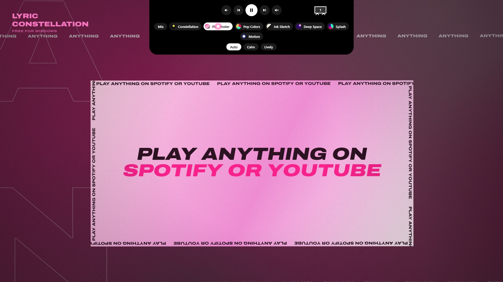
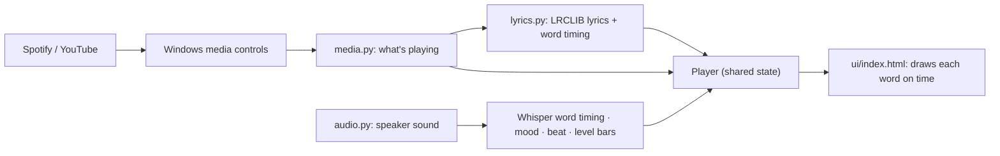

# Lyric Constellation

**Turns whatever you play on Spotify, YouTube Music or YouTube into full-screen, time-synced animated lyrics.**
Every word lights up the moment it's sung, in one of 7 animated styles. No login, no API keys: it reads the song
from Windows itself.



<p>
  <a href="https://github.com/1Dhairyak/Spotify-YouTube-music-visualizer-software/releases/latest/download/LyricConstellation-Windows.zip"></a>
  &nbsp;
  <a href="https://github.com/1Dhairyak/Spotify-YouTube-music-visualizer-software/releases/latest/download/LyricConstellation-Android.apk"></a>
</p>

## Install (Windows 10 / 11)

1. Click **Download for Windows** above and unzip `LyricConstellation-Windows.zip` anywhere (Desktop is fine).
2. Open the folder and double-click **`LyricConstellation.exe`**.
   Windows may say *"Windows protected your PC"* because the app isn't signed: click **More info → Run anyway**.
3. Play a song in Spotify, YouTube Music or YouTube. The lyrics appear within a second or two.

Nothing else to install: Python and everything the app needs are inside the folder. It uses the Microsoft Edge
WebView2 engine, which Windows 11 and up-to-date Windows 10 already have (if the window stays blank, install the
free [WebView2 Runtime](https://developer.microsoft.com/microsoft-edge/webview2/)). To uninstall, delete the folder
and `%APPDATA%\LyricConstellation`.

**Android 8+:** open the `.apk` on your phone to install it, then allow the *microphone*: play a song out loud nearby
and the app recognizes it (like Shazam), then keeps listening every 20 seconds to stay in time. The Android app has
the Constellation look; the Windows app has all 7.

## Features

- **Works with any player.** Reads the song from Windows' media controls (the title in the volume popup), so
  Spotify, YouTube Music and YouTube in any browser all work. If a player reports nothing, it **recognizes the song
  by sound** (Shazam).
- **Synced lyrics** from [LRCLIB](https://lrclib.net), cached so each song is downloaded once.
- **Learns word timing by listening.** Lyrics sites only time each *line*. While an English song plays, Whisper
  (speech recognition, runs offline on the CPU) hears which word is sung when and saves it, so replays follow the
  singing word for word.
- **Knows an emotional song when it hears one.** A small model I trained on 264 labelled songs reads the lyrics
  (English and romanized Hindi/Punjabi) and listens to the music (brightness, drums, beat, swells). Ballads get a
  calm mode: muted colors, slower motion. 93% accurate in cross-validation.
- **Moves with the music:** pulses on the beat, sound-level bars around the album cover, a countdown of the time left.
- **Interactive:** words near the mouse are pushed aside and magnified; click a word to burst it into sparks.
- **Multi-monitor:** lyrics on one screen and the cover on another, chosen with one click.
- **Smooth** at your screen's refresh rate (60, 144, 180 Hz).

### The 7 looks

Each song gets the next look in turn, or pick one (or **Mix**) in the notch at the top of the screen.

| Look | Style |
|---|---|
| Constellation | Glowing stars and lines that flare as each word is sung; 7 sub-styles, 15 colors, a light circling the screen edge |
| Pink Poster | Morphing pink gradients, wide outlined type that fills in, a lettered sphere, shattering glass |
| Pop Colors | Flat bold colors with wipes, mixed fonts, hatched 3D shadows, ring text, tumbling 3D words |
| Ink Sketch | Paper and blackboard, brush lettering, hand-drawn bubbles, a glass that fills as the line is sung |
| Deep Space | Indigo sky with stars, a ringed planet and comets; thin and bold caps that drop and slide in |
| Splash | Mint, indigo and magenta with brush swipes, boiling hand lettering and flying ink blobs |
| Motion | White type on black, 39 text effects (bounce, neon, mirror, slice, drip, handwriting...) |

## How to use it

**The notch:** move the mouse to the black pill at the top center. It holds: play/pause, previous/next, volume,
the seek bar, the looks (or **Mix**), Constellation's color (or **Cycle** or the **album cover's** color),
**Auto · Calm · Lively**, and one button per monitor. Your choices are remembered.

| Key | Does |
|---|---|
| Space | Play / pause the music |
| F11 / F12, Esc | Full screen on / off |
| N | Next look (in Mix: reshuffle) |
| T, 1–7 | Constellation: next sub-style / pick one |
| E, Shift+E | Motion: next / previous effect |
| D / S | All screens or one / swap what each screen shows |
| ← / →, 0 | Shift lyric timing earlier / later, reset |

**Ctrl+Alt+Z from anywhere** (when running from source): double-click `hotkey.pyw` once; the shortcut then opens
or closes the app.

## How it works



Python finds the song and its timed lyrics; a web page in a full-screen window (pywebview + Edge WebView2) draws
them on an HTML canvas, asking Python for the song position 4 times a second and keeping its own clock in between.

**Full walkthrough, file map and interview Q&A: [docs/HOW_IT_WORKS.md](docs/HOW_IT_WORKS.md).**

**Built with:** Python, pywebview, winrt (Windows media API), numpy (FFT audio analysis), faster-whisper,
shazamio, HTML canvas + JavaScript, pytest, ruff, GitHub Actions, PyInstaller.

## Run from source

Needs Windows 10/11 and [Python 3.10+](https://www.python.org/downloads/) (tick *"Add python.exe to PATH"* when
installing it).

- **Easiest:** double-click `install.bat` once, then `run.bat` to start the app.
- **Or in a terminal:**

```powershell
pip install -r requirements.txt
python app.py              # live: follows what you play
python app.py --demo 15    # demo with the first song in songs.txt, 15 seconds in (no music player needed)
```

Other options: `--preload` (download lyrics for every song in `songs.txt`), `--probe` (print what Windows reports
about each player), `--version`. Settings, the lyrics cache and the log are in `%APPDATA%\LyricConstellation`.

## Develop

```powershell
pip install -r requirements-dev.txt
pytest          # 40 tests: lyrics, word timing, title cleanup, cache, mood, listening, screens
ruff check .
```

GitHub Actions runs both on every push.

- **Build the Windows download:** `python -m PyInstaller LyricConstellation.spec`, then zip `dist/LyricConstellation`
  as `LyricConstellation-Windows.zip`.
- **Retrain the mood model:** `python tools/train_mood.py fetch`, then `python tools/train_mood.py train`
  (prints its accuracy and writes `lyric_constellation/mood_model.json`).
- **Add or drop a look:** each look is one file in `ui/looks/` plus one `<script>` line in `ui/index.html`.
- **Android:** `android/gradlew assembleRelease` (the app is `ui/index.html` with the Constellation look, plus
  `android/web/android.js` in place of Python, and a Java port of SongRec's Shazam fingerprinting).

## License

MIT, except the Android app in `android/`, which is GPL-3.0 (it ports SongRec's GPL code); see [NOTICE.md](NOTICE.md).
Fonts in `ui/fonts/` are from Google Fonts under the SIL Open Font License (Permanent Marker: Apache 2.0).
