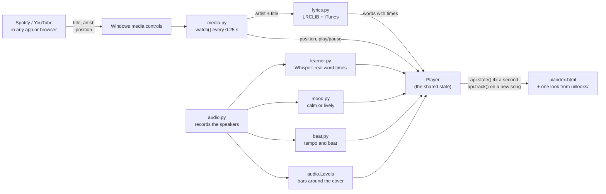

# How Lyric Constellation works

A plain-English tour of the code: what happens from the moment you press play in Spotify to the moment a word
lights up on screen. Read this first, then open the files in the order of the map below.

## The idea in one sentence

Windows already knows what song you are playing (it shows it in the volume popup). The app reads that, downloads
lyrics that say *when* each line is sung, and draws each word in time with the music, full screen, in one of 7
animated styles ("looks").

## The journey of one song



1. **What's playing?** `media.py` → `watch()` asks Windows 4 times a second which media players exist and what
   each one is playing. It follows the one that is playing.
2. **New song?** If the title changed, `load_track()` runs: it shows the title straight away, then
   `lyrics.clean()` tidies the title (`"Song (Official Video)"` → `"Song"`), and `lyrics.fetch_lyrics()` downloads
   time-stamped lyrics from [LRCLIB](https://lrclib.net) (or reads them from the cache folder), and
   `lyrics.cover_url()` finds large album art on iTunes.
3. **When is each word sung?** LRCLIB only gives the start of each *line*. `lyrics.word_times()` spreads the words
   of a line out by their length as a first guess.
4. **Shared state.** Everything ends up in one `Player` object (`media.py`): the current song, its words, and a
   clock (`Player.now()` = last known position + time since).
5. **The window.** `window.py` opens a full-screen window (pywebview, using the Edge WebView2 engine that comes with
   Windows) showing `ui/index.html`. The page calls Python functions through `pywebview.api`: `state()` 4 times a
   second for the position, and `track()` when the song changes.
6. **Drawing.** In the page, `frame()` runs once per screen refresh (60, 144, 180 Hz...). It asks the current look
   to draw the words that are being sung *right now* onto a `<canvas>`.
7. **Listening (optional extras).** `audio.py` records what the speakers play and passes it to:
   - `learner.py`: Whisper (speech recognition) hears the exact moment each word is sung and saves it, so the next
     play is word-perfect.
   - `mood.py`: a small trained model decides whether the song is emotional; ballads get a calmer look.
   - `beat.py`: finds the tempo so the screen pulses on the beat.
   - `audio.Levels`: the bass-to-treble bars around the album cover.
8. **No player reports anything?** (Some browsers don't.) `media.recognize()` records 6 seconds and asks Shazam.

## File map

Read them roughly in this order. Every file starts with a comment saying what it does.

| File | What it does | Lines |
|---|---|---|
| `app.py` | Starts the app (one line: calls `main()`) | 8 |
| `lyric_constellation/__main__.py` | The start: command-line options, logging, starts everything | ~160 |
| `lyric_constellation/media.py` | Reads Windows' media controls, Shazam, and the `Player` state | ~360 |
| `lyric_constellation/lyrics.py` | Downloads lyrics, parses time stamps, word timing, title cleanup | ~280 |
| `lyric_constellation/window.py` | The full-screen windows and the functions the page can call | ~280 |
| `lyric_constellation/audio.py` | Records the speakers; measures levels for the cover bars | ~130 |
| `lyric_constellation/learner.py` | Learns real word times with Whisper | ~125 |
| `lyric_constellation/mood.py` | Calm-or-lively model (lyrics + sound) | ~220 |
| `lyric_constellation/beat.py` | Tempo and beat detection | ~130 |
| `lyric_constellation/__init__.py` | Version, folders, JSON helpers | ~55 |
| `ui/index.html` | The screen: polling Python, the clock, the mouse, the notch, keys | ~1,060 |
| `ui/looks/*.js` | The 7 looks, one file each | 250–670 each |
| `tests/` | 40 automatic tests (run `pytest`) | |
| `tools/train_mood.py` | Trains the mood model (developer tool, not part of the app) | |
| `hotkey.pyw` | Optional: Ctrl+Alt+Z opens/closes the app from anywhere | |

## Where things are saved

Everything per-user goes in `%APPDATA%\LyricConstellation`:
- `cache\*.json`: lyrics, one file per song, plus the word times Whisper learned for it
- `settings.json`: the look, color and screens you picked
- `lyric-constellation.log`: what the app did (open it if something looks wrong)

## Tech stack

| Part | Choice | Why |
|---|---|---|
| Language | Python 3.10+ | Good libraries for audio, Windows APIs and machine learning |
| Window | pywebview (Edge WebView2) | Draw with HTML canvas, fast GPU drawing, no heavy game engine |
| Song info | winrt (Windows media controls) | Works with every player, no logins or API keys |
| Lyrics | LRCLIB | Free, open, time-stamped lyrics |
| Cover art | iTunes Search API | Free, large images |
| Recognize by sound | shazamio | Same as the Shazam app |
| Word timing | faster-whisper (small.en) | Speech recognition on the CPU, offline after first download |
| Audio maths | numpy (FFT, autocorrelation) | Beat, mood and level analysis without heavy libraries |
| Tests / lint | pytest, ruff, GitHub Actions | Every push is checked automatically |
| Packaging | PyInstaller | One folder with an .exe; no Python needed on the other PC |

## Interview questions you can expect

**Why a web page inside a window, not a normal desktop UI?**
Animated typography needs smooth drawing at the screen's refresh rate. The HTML canvas in WebView2 is
GPU-accelerated and already on every Windows 10/11 PC, so the app gets that for free and stays small.

**How do the words stay in sync with the music?**
Windows gives the player's position every few seconds. Between updates the app keeps its own clock: last position
plus the time passed since. The page does the same between its polls. So words move smoothly, and get corrected
whenever the player reports a new position (for example after you skip ahead).

**The lyrics only time each line. How do you time each word?**
First a guess: words are spread across the line by their length. Then, while the song plays, Whisper listens to the
speakers and writes down which word it hears when. Those words are matched to the lyrics with `difflib` (runs of 2+
words in order, so a lone "the" can't match anywhere), and the times are saved. A chorus later in the song borrows
the times heard for its twin line.

**How does it know a song is emotional?**
Two small logistic-regression models trained on 264 songs I labelled: one on the lyrics (which words, how densely
they are sung, how much repeats), one on the sound (brightness, drums, beat regularity, swells). A third step joins
them, trusting the sound more as more of the song is heard. It scores 93% in cross-validation and 84% on 51 songs it
never saw. All features ignore the volume knob.

**What was the hardest part?**
Timing. The player's position lags, Whisper's words need matching to messy lyrics, and the beat must line up with
what you hear (the `LAG` setting in `beat.py`). Second: songs from browsers, where titles look like
"Artist - Song (Official Video) | HD" and some browsers report no position at all, hence the Shazam fallback.

**What would you do next?**
An installer with a Start-menu shortcut, code signing (so Windows SmartScreen doesn't warn), and letting users
correct the mood so the model can improve.

## Checking it works

```powershell
pip install -r requirements-dev.txt
pytest          # 40 tests: lyrics parsing, word timing, title cleanup, cache, mood, listening, screens
ruff check .    # code style and mistakes
python app.py --demo 15   # the app with a sample song, no music player needed
```
